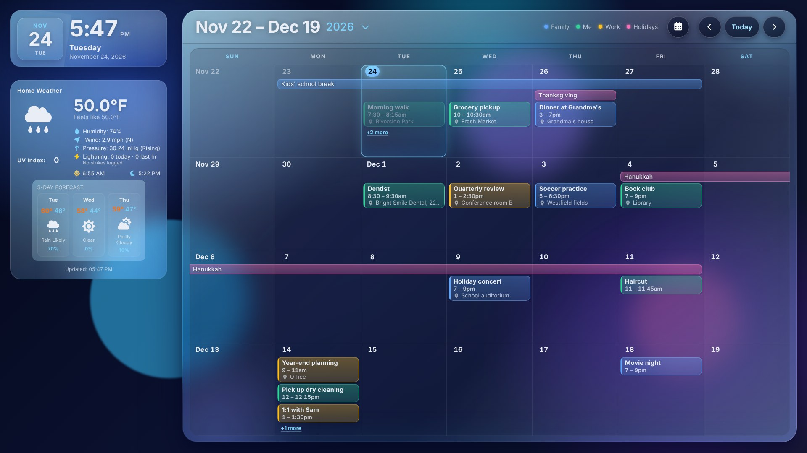
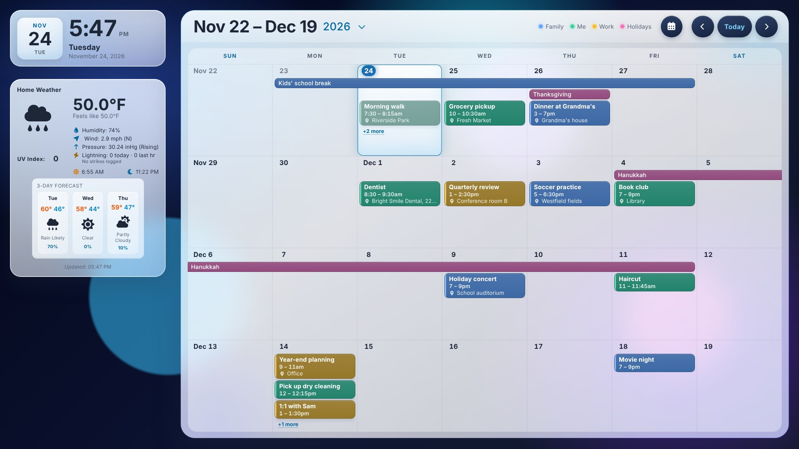
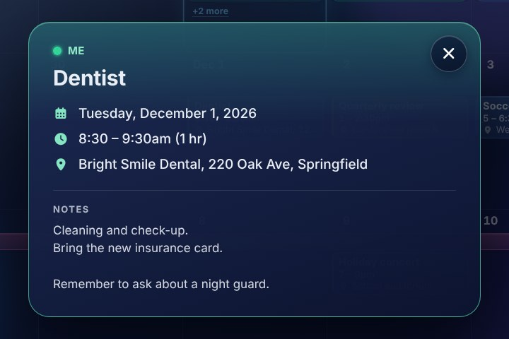
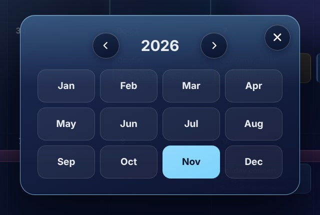

# MMM-GlassMonthlyCalendar

> **Status:** in active development. Options may still change.

A touch-friendly calendar for [MagicMirror²](https://magicmirror.builders), drawn as a large
liquid-glass window. It shows events from MagicMirror's built-in `calendar` module (Google Calendar,
iCloud or any iCal feed) as cards with the title, time and location, one color per calendar.

It pairs with [MMM-GlassClock](https://github.com/scottshaffer/MMM-GlassClock) and
[MMM-GlassTempest](https://github.com/scottshaffer/MMM-GlassTempest), and it works on its own too.



## Features

- **Cards for every event**: title, start and end time, location, tinted in the calendar's color.
  All-day and multi-day events are bars across the days. When a day is full, "+N more" opens the
  rest.
- **One color per calendar**, with a legend, picked automatically or set by you.
- **Fills the screen**: as tall as the display and as wide as the space beside the Glass cards.
- **Touch controls**: ‹ Today › to move through time, a calendar button to switch between 2 and 4
  weeks, a month picker, and a details card for any event.
- **Day and night looks** that switch at sunrise and sunset.
- Every option of [MMM-MonthlyCalendar](https://github.com/kolbyjack/MMM-MonthlyCalendar) still works,
  so you can swap one for the other.



## Install

```bash
cd ~/MagicMirror/modules
git clone https://github.com/scottshaffer/MMM-GlassMonthlyCalendar.git
```

There is nothing to `npm install`. To update later: `cd MMM-GlassMonthlyCalendar && git pull`, then
restart MagicMirror.

## Set up

Add two entries to `~/MagicMirror/config/config.js`: the built-in `calendar` module, which fetches
your calendars, and this module, which shows them.

```js
{
  module: "calendar",            // no position: it only feeds this module
  config: {
    broadcastPastEvents: true,   // keep earlier days of the month filled in
    maximumEntries: 1000,
    calendars: [
      { name: "Family",   url: "https://calendar.google.com/calendar/ical/…/basic.ics" },
      { name: "Work",     url: "https://calendar.google.com/calendar/ical/…/basic.ics" },
      { name: "Holidays", url: "https://calendar.google.com/calendar/ical/…/basic.ics", color: "#f472b6" }
    ]
  }
},
{
  module: "MMM-GlassMonthlyCalendar",
  position: "top_right",
  config: {
    mode: "fourWeeks",
    dayMode: "auto"
  }
},
```

- **Google Calendar address:** in Google Calendar on a computer, open the calendar's *Settings and
  sharing* and copy *Secret address in iCal format*.
- **Give every calendar a `name`.** Names tell the calendars apart: each gets its own color and an
  entry in the legend. Calendars without a `color` get one automatically.
- **Events appear a few seconds after startup**, once the calendar module has fetched the feeds.

### Layout

The calendar sizes itself to the screen. With the Glass cards in `top_left` and the calendar in
`top_right`, it leaves 380 px for the cards (`reserveWidth`) and fills the rest, top to bottom.

For more room, shrink MagicMirror's 60 px screen margin in `~/MagicMirror/css/custom.css`:

```css
body {
  margin: 24px;
  height: calc(100% - 48px);
  width: calc(100% - 48px);
}
```

Without the Glass cards beside it, set `reserveWidth: 0` and `reserveGap: 0`. In a full-width region such as `bottom_bar`, use
`width: "100%"`.

### Day and night

With `dayMode: "auto"` the calendar turns light at sunrise and dark at sunset. It takes the times
from MMM-GlassTempest when that module is on the mirror. Otherwise set `latitude` and `longitude`,
or it is light from 07:00 to 19:00. Give MMM-GlassClock and MMM-GlassTempest `dayMode: "auto"` too
and all three switch together.

## Using it

| Tap | What happens |
| :-- | :-- |
| An event | A card with its calendar, title, date, times, location and notes |
| "+N more" | Every event that day; tap one for its details |
| The dates in the title | Month picker: jump to any month (arrows change the year) |
| Calendar button | Switch between 2 weeks and 4 weeks |
| ‹ › and Today | Move back or forward, or return to today |

Two minutes after you move away from today, the calendar goes back to it (`navigationResetSeconds`),
and an open card closes after 30 seconds (`popupTimeout`).

<p>
  
  
</p>

The calendar can only show what the calendar module has fetched: by default events up to a year
ahead, and past events only with `broadcastPastEvents: true`.

## Options

All options are optional. The ones you are most likely to change come first.

| Option | Default | Description |
| :-- | :-- | :-- |
| `mode` | `"currentMonth"` | Starting view: `twoWeeks`, `fourWeeks`, `currentMonth`, also `currentWeek`, `threeWeeks`, `lastMonth`, `nextMonth` |
| `dayMode` | `"none"` | `"auto"` (light from sunrise to sunset), `"day"`, `"night"`, or `"none"` (follow a theme's `body.mm-day`) |
| `firstDayOfWeek` | `"sunday"` | Any weekday, or `"today"` |
| `viewSwitch` | `["twoWeeks", "fourWeeks"]` | Views the calendar button steps through; add `"currentMonth"` for Month view; `[]` hides the button |
| `hideCalendars` | `[]` | Calendar names to leave out |
| `colorPalette` | 8 colors | Colors given to calendars without their own `color` |
| `showLocation` | `true` | Location line on event cards |
| `showEndTime` | `true` | "9:45 – 11am" rather than "9:45am" |
| `titleLines` | `2` | Long titles wrap to this many lines (1 or 2) |
| `eventLayout` | `"cards"` | `"compact"` gives one line per event, as in MMM-MonthlyCalendar |
| `reserveWidth` / `reserveGap` | `380` / `30` | Width left beside the calendar for the Glass cards, px |
| `width` / `height` | `"fill"` | `"fill"` uses the screen; or any CSS width / a height in px (`height: "auto"` uses `rowHeight`) |
| `navigationResetSeconds` | `120` | Seconds after moving away from today before it goes back; `0` = never |
| `popupTimeout` | `30` | Seconds an event card stays open before closing by itself; `0` = stays open until closed |
| `eventPopup` / `monthPicker` / `touchNavigation` | `true` | Turn off tapping events, the month picker, or the ‹ Today › buttons |
| `showHeader` / `showLegend` | `true` | Title bar; calendar legend (shown with 2 or more calendars) |
| `latitude` / `longitude` | `null` | Location for `dayMode: "auto"` when MMM-GlassTempest isn't used |
| `dayStart` / `dayEnd` | `"07:00"` / `"19:00"` | Light hours for `dayMode: "auto"` with neither GlassTempest nor a location |
| `dayModeScope` | `"calendar"` | `"page"` sets `body.mm-day` on the whole page instead of styling only this module |
| `sunNotification` | `"AMBIENT_WEATHER_DATA"` | Notification with `sunrise` / `sunset` (MMM-GlassTempest's weather broadcast) |
| `calendarColors` | `"auto"` | `"off"` uses colors exactly as the calendar module sends them |
| `showWeekNumber` | `false` | ISO week numbers at the start of each row |
| `displaySymbol` | `false` | The calendar's Font Awesome symbol before each title |
| `wrapTitles` | `false` | Compact layout: wrap long titles instead of cutting them off |
| `weekdayFormat` | `"short"` | `"long"`, `"short"` or `"narrow"` |
| `highlightWeekends` / `dimPastEvents` | `true` | Tint weekends; fade events that have ended |
| `eventStyle` | `"glass"` | `"solid"` gives solid color blocks (text color set by `luminanceThreshold`, 110) |
| `maxEventLanes` | `0` | Rows of all-day bars per week before "+N more"; `0` = as many as fit |
| `hideDuplicateEvents` | `true` | Show an event that is in two calendars only once |
| `multiDayEndingTimeSeparator` | `" until "` | Compact layout: text before a multi-day event's end time |
| `maxWidth` / `rowHeight` | `0` / `128` | Width cap in px (`0` = none); row height with `height: "auto"` |
| `locale` / `timeFormat` | `null` | Override MagicMirror's `language` / `timeFormat` (12 or 24) |
| `updateDelay` / `animationSpeed` | `5` / `600` | Seconds to wait for all calendars; redraw fade in ms |
| `performanceProfile` / `reduceMotion` | `"auto"` / `false` | `"pi"` or `reduceMotion: true` turn off the window's background animation |

Day-mode event colors can be made darker or lighter in `custom.css` (lower = darker):
`.gmc-window { --gmc-day-shade: 50%; }` (default 58%).

## Tests

```bash
npm test
```

## Credits

- This module was mostly written by Claude Opus
- Calendar logic and options from [MMM-MonthlyCalendar](https://github.com/kolbyjack/MMM-MonthlyCalendar)
  by Jonathan Kolb (MIT).
- Liquid-glass recipe from [MMM-AmbientWeather](https://github.com/hearter20176/MMM-AmbientWeather)
  by Harry Arter (MIT), as used in MMM-GlassTempest and MMM-GlassClock.

## License

MIT, see `LICENSE`.
