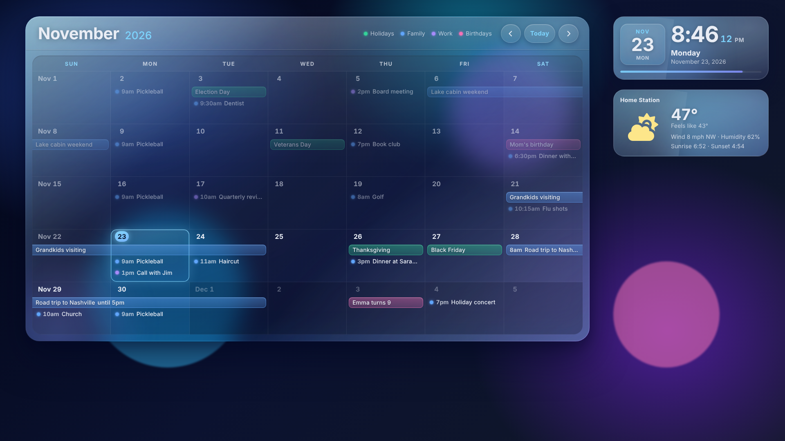
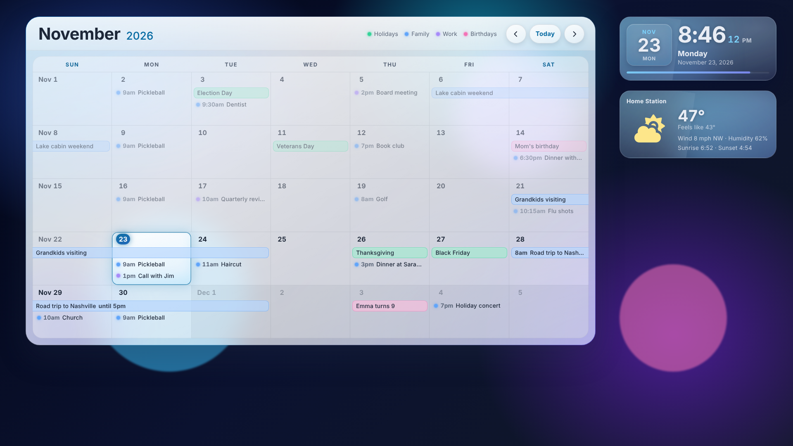
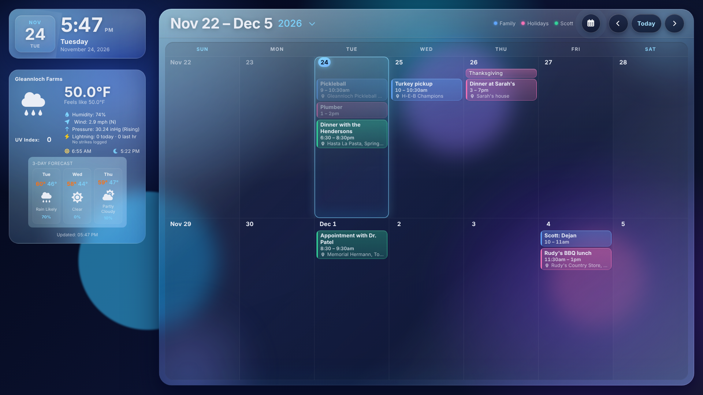
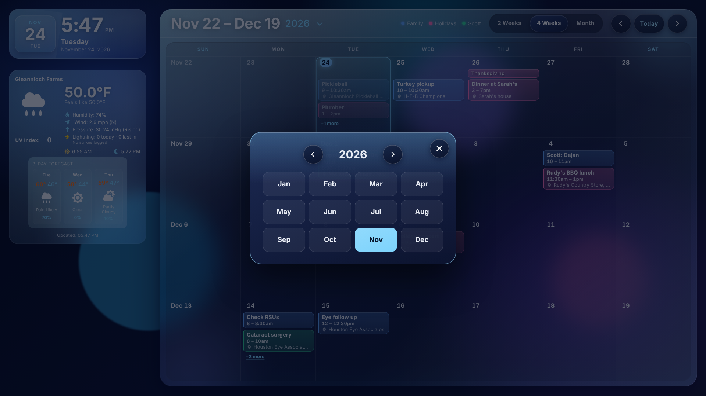
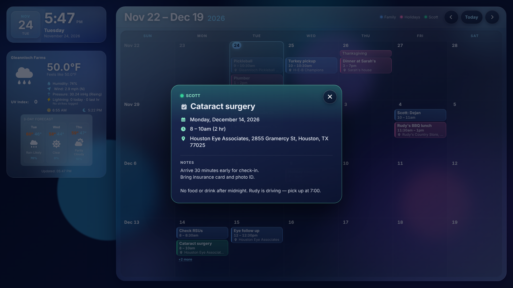

# MMM-GlassMonthlyCalendar

THIS MODULE IS IN ACTIVE DEVELOPMENT - THE README IS NOT RIGHT!

A month calendar for MagicMirror², drawn as a large liquid-glass **main window**. It is part of the
same family as [MMM-GlassClock](https://github.com/scottshaffer/MMM-GlassClock) and
[MMM-GlassTempest](https://github.com/scottshaffer/MMM-GlassTempest), but it is meant to be the
centre of the display, so it reads as a different object from those cards.

It has every feature and option of [MMM-MonthlyCalendar](https://github.com/kolbyjack/MMM-MonthlyCalendar)
(same option names, same defaults), so you can swap one for the other.



## How it differs from the cards

The clock and weather cards are small floating panes with a moving shimmer. The calendar window is:

- **Bigger and heavier glass**: deeper blur and tint, a larger corner radius and a deeper shadow.
- **Edged with light**: a gradient rim that is bright at the top-left and bottom-right corners.
- **Built like a window**: a frosted title bar with the month in large type and the year in the
  accent color, the calendar legend, and touch arrows; the grid sits on a darker inner sheet.
- **Calm**: a slow highlight in place of the sweeping shimmer, and glows in two corners so it frames
  the cards beside it.

It uses the same colors, font and theme variables (`--mm-text`, `--mm-text-2`, `--mm-accent-2`,
`body.mm-day`) as the cards, so the set still matches.

## Features

- Every MMM-MonthlyCalendar mode: `lastMonth`, `currentMonth`, `nextMonth`, `currentWeek`, `twoWeeks`,
  `threeWeeks`, `fourWeeks`
- Events from every instance of the default `calendar` module (`CALENDAR_EVENTS`), merged, sorted and
  with duplicates removed
- All-day and multi-day events as glass bars in the calendar's color. A bar that runs into the next
  week has an open, square edge
- Timed events are cards in the calendar's color, like a Skylight display: the title (wrapping to
  two lines when it is long), the time range ("9:45 – 11am") and the location. A card that is
  happening now gets a brighter rim. `eventLayout: "compact"` keeps the original one-line entries
  ("9am Pickleball"), and timed multi-day events end with "until 5pm" as in the original
- The window fills the screen's height and the width beside the Glass cards, and each day shows as
  many cards as fit, then "+N more"
- Today is a raised glass tile. Past days are dimmed and days from other months are shaded
- Week numbers, Font Awesome calendar symbols, wrapped or truncated titles, hidden calendars
- Extras: calendar legend, touch arrows with auto-return, `maxEventLanes` with "+N more", weekend
  tint, dimmed past events, redraw at midnight
- `eventStyle: "solid"` gives you the original look: solid bars, black or white text chosen by
  `luminanceThreshold`, and colored text for timed events
- Light "day mode", switched on all the time or at sunrise and sunset (see below), plus the Pi /
  reduced-motion profile used by the other Glass modules. No npm packages are needed

## Installation

```bash
cd ~/MagicMirror/modules
git clone https://github.com/scottshaffer/MMM-GlassMonthlyCalendar.git
```

There is nothing to `npm install`.

## Setup

This module shows events from MagicMirror's default `calendar` module, the same way
MMM-MonthlyCalendar does. Keep a `calendar` entry with your feeds. Give it no `position` if you
don't want its list on screen as well.

```js
{
  module: "calendar",
  config: {
    broadcastPastEvents: true,   // so earlier days of the month still show their events
    maximumEntries: 10000,       // see MMM-MonthlyCalendar issue #48 (MagicMirror 2.30)
    maximumNumberOfDays: 62,
    calendars: [
      { name: "Family",   url: "https://…/family.ics",   color: "#60a5fa", symbol: "house" },
      { name: "Holidays", url: "https://…/holidays.ics", color: "#34d399", symbol: "flag" }
    ]
  }
},
{
  module: "MMM-GlassMonthlyCalendar",
  position: "top_left",
  config: {
    maxEventLanes: 4
  }
},
{ module: "MMM-GlassClock",   position: "top_right", config: { /* … */ } },
{ module: "MMM-GlassTempest", position: "top_right", config: { /* … */ } },
```

### Several calendars, one color each

Give every calendar a `name` in the calendar module. The calendar tells calendars apart by name,
shows each name in the legend, and tints each calendar's events in its own color:

```js
calendars: [
  { name: "Scott",    url: "https://calendar.google.com/calendar/ical/…/basic.ics" },
  { name: "Family",   url: "https://calendar.google.com/calendar/ical/…/basic.ics" },
  { name: "Holidays", url: "https://calendar.google.com/calendar/ical/…/basic.ics" }
]
```

- A calendar with its own `color` (e.g. `color: "#f472b6"`) keeps it.
- A calendar without one (the calendar module then sends white) gets a different color from
  `colorPalette`: blue, pink, green, amber, violet, red, cyan, orange. Colors are given out in name
  order and skip colors you already set, so each calendar keeps the same color.
- Calendars without a `name` can't be told apart and share one color.
- `calendarColors: "off"` uses the colors exactly as the calendar module sends them.

### Layout on a 1920×1080 screen

With the defaults (`height: "fill"`, `width: "fill"`) the window runs from the top of the screen to
the bottom margin and takes all the width except `reserveWidth` (380 px, the width of the Glass
cards) plus `reserveGap` (30 px). It works out the space from the browser window and MagicMirror's
page margins, and redraws if the screen size changes. Put the calendar in `top_right` and the cards
in `top_left`, or the other way round.

The week rows share the height evenly, and each day shows as many event cards as fit, then
"+N more". For more room per day:

- `mode: "twoWeeks"` (or `"threeWeeks"`) gives each week more height.
- MagicMirror's page margin is 60 px on every side. A smaller margin in `custom.css` gives the
  calendar more room:

  ```css
  body {
    margin: 24px;
    height: calc(100% - 48px);
    width: calc(100% - 48px);
  }
  ```

- `showLocation: false` makes cards one line shorter; `titleLines: 1` keeps titles to one line.

`height: "auto"` and a CSS `width` (for example `"100%"` in a bar region) go back to sizing by
`rowHeight`.

### Day mode (the light calendar)



### Switching views and picking a month

The calendar button in the title bar switches between the 2-week and 4-week views: each tap moves
to the other one. The view you pick stays until you tap again (or MagicMirror restarts); `mode` is
the view it starts in. Switching keeps roughly the same dates in view. To add Month view to the
rotation, use `viewSwitch: ["twoWeeks", "fourWeeks", "currentMonth"]`.



Tap the title (the dates, with the ⌄ beside them) to open a month picker: the 12 months of a year,
with arrows to change the year. The current month is outlined and the month in view is filled. Pick
a month and the 2- and 4-week views start at the week holding its 1st; Month view shows the whole
month. ‹ › then step on from there, and **Today** (or `navigationResetSeconds` of no use) comes back.



The calendar can only show events the calendar module has fetched: by default up to a year ahead
(its `maximumNumberOfDays`, 365), and past events only with `broadcastPastEvents: true`.

### Event details

Tap any event (a card, an all-day bar, or a compact entry) to open a card with everything the
calendar module knows about it: the calendar it comes from (with its color), the title, the date,
the times and duration (or "All day"), whether it has ended or is happening now, the location, and
the event's notes (its description). Tap "+N more" for a list of every event that day; tap one in
the list for its details. Tap ✕ or anywhere outside the card to close it. It also closes by itself
after `popupTimeout` seconds and when you change month.



Notes come from Google Calendar's description field. Any formatting in them (links, bold) is shown
as plain text.

MagicMirror itself has no day/night theme, so the calendar can switch itself:

```js
config: {
  dayMode: "auto"      // light from sunrise to sunset
}
```

With `"auto"`, the calendar gets today's sunrise and sunset from
[MMM-GlassTempest](https://github.com/scottshaffer/MMM-GlassTempest), which broadcasts them with
every weather update. Nothing else is needed if GlassTempest is on the mirror.

- Without GlassTempest (or until its first update after startup), it uses `latitude` and
  `longitude` if you set them, and otherwise is light from `dayStart` to `dayEnd` (07:00–19:00).
- If you changed GlassTempest's `weatherNotification`, set `sunNotification` to the same name.
  Any module that sends `sunrise` and `sunset` in a notification works the same way.
- `dayMode: "day"` keeps it light all the time; `"night"` keeps it dark.
- In day mode each calendar's events are a deep shade of its color with white text. To make them
  lighter or darker, set the share of the calendar color kept (lower = darker) in `custom.css`:
  `.gmc-window { --gmc-day-shade: 50%; }` (default 58%).
- `dayModeScope: "calendar"` (the default) switches only this window. To switch the clock and
  weather cards at the same moment, also give MMM-GlassClock and MMM-GlassTempest (0.2.0 or
  later) `dayMode: "auto"`.
- `dayModeScope: "page"` instead puts `mm-day` on the whole page, for themes and modules that
  restyle themselves from it (MMM-GlassClock and MMM-GlassTempest do).
- `dayMode: "none"` (the default) leaves it to a theme: the calendar turns light only if something
  else sets `body.mm-day`.

### Sample config entry

Every option at its default:

```js
{
  module: "MMM-GlassMonthlyCalendar",
  position: "top_left",
  config: {
    // Same as MMM-MonthlyCalendar
    mode: "currentMonth",          // lastMonth | currentMonth | nextMonth | currentWeek | twoWeeks | threeWeeks | fourWeeks
    firstDayOfWeek: "sunday",      // any weekday, or "today"
    showWeekNumber: false,
    displaySymbol: false,
    wrapTitles: false,
    hideCalendars: [],
    luminanceThreshold: 110,
    multiDayEndingTimeSeparator: " until ",
    hideDuplicateEvents: true,

    // Colors per calendar
    calendarColors: "auto",        // "auto" | "off"
    colorPalette: ["#60a5fa", "#f472b6", "#34d399", "#fbbf24", "#a78bfa", "#f87171", "#22d3ee", "#fb923c"],

    // Main window
    eventLayout: "cards",          // "cards" | "compact"
    showEndTime: true,
    showLocation: true,
    titleLines: 2,
    height: "fill",                // "fill" | "auto" | px
    width: "fill",                 // "fill" | any CSS width
    reserveWidth: 380,
    reserveGap: 30,
    showHeader: true,
    showLegend: true,
    weekdayFormat: "short",        // "long" | "short" | "narrow"
    highlightWeekends: true,
    dimPastEvents: true,
    eventStyle: "glass",           // "glass" | "solid"
    rowHeight: 128,
    maxEventLanes: 0,              // 0 = as many as fit
    maxWidth: 0,

    // Touch
    touchNavigation: true,
    navigationResetSeconds: 120,
    viewSwitch: ["twoWeeks", "fourWeeks"],
    monthPicker: true,
    eventPopup: true,
    popupTimeout: 45,

    // Behaviour
    updateDelay: 5,
    animationSpeed: 600,
    locale: null,                  // null = MagicMirror's language
    timeFormat: null,              // 12 | 24 | null (MagicMirror's timeFormat)
    performanceProfile: "auto",    // "auto" | "pi" | "full"
    reduceMotion: false,

    // Day mode
    dayMode: "none",               // "none" | "day" | "night" | "auto"
    sunNotification: "AMBIENT_WEATHER_DATA",
    dayModeScope: "calendar",      // "calendar" | "page"
    latitude: null,
    longitude: null,
    dayStart: "07:00",
    dayEnd: "19:00"
  }
},
```

### Options

Options from MMM-MonthlyCalendar:

| Option | Default | Description |
| :-- | :-- | :-- |
| `mode` | `"currentMonth"` | `lastMonth`, `currentMonth`, `nextMonth`, `currentWeek`, `twoWeeks`, `threeWeeks` or `fourWeeks` (`oneWeek`, `nextOneWeek` and `nextFourWeeks` are also accepted, as in the original) |
| `firstDayOfWeek` | `"sunday"` | First column. `"today"` always puts today in the first column |
| `showWeekNumber` | `false` | ISO week number at the start of each row |
| `displaySymbol` | `false` | Show the calendar's Font Awesome symbol before each event |
| `wrapTitles` | `false` | Wrap long titles instead of cutting them off with "…" |
| `hideCalendars` | `[]` | Calendar names to leave out |
| `luminanceThreshold` | `110` | With `eventStyle: "solid"`, bars brighter than this get black text |
| `multiDayEndingTimeSeparator` | `" until "` | Text before the end time on the last day of a timed multi-day event |
| `hideDuplicateEvents` | `true` | Show events with the same title, start and end only once |

Options added by this module (colors):

| Option | Default | Description |
| :-- | :-- | :-- |
| `calendarColors` | `"auto"` | `"auto"`: each calendar without its own `color` gets a different color from `colorPalette`. `"off"`: colors exactly as sent (white when unset) |
| `colorPalette` | 8 colors | Colors handed out to calendars, in order of calendar name |

Options added by this module:

| Option | Default | Description |
| :-- | :-- | :-- |
| `showHeader` | `true` | Title bar with the month and year (the date range in week modes) |
| `showLegend` | `true` | Calendar names and colors in the title bar (shown when there are 2 or more calendars) |
| `weekdayFormat` | `"short"` | Weekday names: `"long"`, `"short"` or `"narrow"` |
| `highlightWeekends` | `true` | Light tint on Saturday and Sunday |
| `dimPastEvents` | `true` | Fade events that have already ended |
| `eventStyle` | `"glass"` | `"glass"` (tinted glass bars and color dots) or `"solid"` (the original look) |
| `eventLayout` | `"cards"` | `"cards"`: timed events as cards with title, time range and location. `"compact"`: one line per event, as in MMM-MonthlyCalendar |
| `showEndTime` | `true` | Cards show "9:45 – 11am" instead of "9:45am" |
| `showLocation` | `true` | Cards show the event's location (its first line) |
| `titleLines` | `2` | Long card titles wrap to this many lines (1 or 2) |
| `height` | `"fill"` | `"fill"`: the full screen height. `"auto"`: `rowHeight` per week. Or a height in px |
| `width` | `"fill"` | `"fill"`: the screen width minus `reserveWidth` + `reserveGap`. Or any CSS width, e.g. `"1400px"` or `"100%"` |
| `reserveWidth` / `reserveGap` | `380` / `30` | Space `width: "fill"` leaves for the Glass cards beside the calendar, px |
| `maxWidth` | `0` | Cap on the window width, px (`0` = no cap) |
| `rowHeight` | `128` | With `height: "auto"`: minimum height of each week row, px |
| `maxEventLanes` | `0` | Rows of all-day / multi-day bars per week (compact: rows of events) before "+N more"; `0` = as many as fit |
| `touchNavigation` | `true` | ‹ Today › buttons in the title bar. They move by a month, or by the view length in week modes. A pressed button lights up, then flashes once when the view changes |
| `viewSwitch` | `["twoWeeks", "fourWeeks"]` | Views the calendar button steps through, one per tap (any of the `mode` values); `[]` hides the button |
| `monthPicker` | `true` | Tap the title to pick a month to show |
| `eventPopup` | `true` | Tap an event for its details; tap "+N more" for the day's list. `false` turns tapping off |
| `popupTimeout` | `45` | Seconds before an open popup closes by itself; `0` = stays open until closed |
| `navigationResetSeconds` | `120` | Go back to today after this many seconds (the chosen view stays); `0` = stay |
| `updateDelay` | `5` | Seconds to wait for all calendars to report before redrawing (fixed at 5 in the original) |
| `animationSpeed` | `600` | Cross-fade when the grid redraws, ms |
| `locale` | `null` | e.g. `"en-GB"`, `"de"`; `null` follows MagicMirror's `language` |
| `timeFormat` | `null` | `12` or `24`; `null` follows MagicMirror's `timeFormat` |
| `performanceProfile` | `"auto"` | `"pi"` turns off the window's slow highlight and glow animation |
| `reduceMotion` | `false` | Same as the Pi profile, on any device |
| `dayMode` | `"none"` | `"day"` (always light), `"night"` (always dark), `"auto"` (light from sunrise to sunset), or `"none"` (light only if a theme sets `body.mm-day`) |
| `dayModeScope` | `"calendar"` | `"calendar"` lightens this window only; `"page"` sets `body.mm-day` for the whole page |
| `sunNotification` | `"AMBIENT_WEATHER_DATA"` | Notification that carries `sunrise` / `sunset` (MMM-GlassTempest's weather broadcast) for `dayMode: "auto"` |
| `latitude` / `longitude` | `null` | Fallback location for `dayMode: "auto"` when no sun times have been broadcast |
| `dayStart` / `dayEnd` | `"07:00"` / `"19:00"` | Light hours for `dayMode: "auto"` when no location is set |

## Notes

- Events appear a few seconds after startup, once the calendar module has fetched its feeds.
- This module fixes two problems in the original. `nextMonth` and `lastMonth` no longer skip a month
  when today is the 29th to 31st. The highlighted day now moves at midnight even if no new calendar
  data arrives.

## Tests

```bash
npm test
```

## Credits

- This module was mostly written by Claude Opus 
- Calendar logic and options from [MMM-MonthlyCalendar](https://github.com/kolbyjack/MMM-MonthlyCalendar)
  by Jonathan Kolb (MIT).
- Liquid-glass recipe from [MMM-AmbientWeather](https://github.com/hearter20176/MMM-AmbientWeather)
  by Harry Arter (MIT), as used in MMM-GlassTempest and MMM-GlassClock.

## License

MIT, see `LICENSE`.
